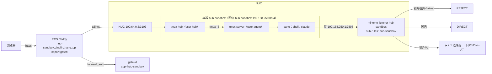

# 002 · hub-sandbox：Docker 隔离的 tmux-hub 实例

> 状态：已实现，NUC 本机验收通过；待 mihomo 上线与 edge 部署（2026-10-18）
> 关联改动：tmux-hub（本 PR）· proxy-infra（mihomo listener）· edge-gateway（Caddy 站点 + gate-id app）

---

## 1 需求

### 1.1 背景

NUC 上现有两个 tmux-hub 实例：`hub`（prod，3101）和 `hub-dogfood`（3102）。两者都以宿主用户 `uther` 运行，每个 pane 都是 `uther` 的 shell。`uther` 属于 `sudo` 和 `docker` 组，所以从这两个实例开出的 pane 实际上等于宿主 root。

### 1.2 目标

新增第三个实例 `hub-sandbox`，满足：

1. **使用者**：仅限本人。用独立的 gate-id 账号登录，用本人的 Claude 账号跑 Claude Code。不提供给他人使用（受 Claude 消费者条款约束，见 §7）。
2. **隔离**：pane 里的进程（包括开了 bypass permissions 的 agent）碰不到宿主文件系统、宿主凭证、`docker.sock`，也碰不到局域网、tailnet 和宿主上的其他服务。
3. **出网**：所有出网流量只能经过 mihomo，由 mihomo 统一分流：国内直连，境外和 AI 走现有的选择组（当前为 `日本-TY-4-AT`）。
4. **入口**：`https://hub-sandbox.qinglinzhang.top`，复用现有的 Caddy `gated` 和 gate-id 鉴权。

### 1.3 非目标

- 不做多租户，也不为他人开放。
- 不上 KVM 虚拟机。威胁模型是"失控或被注入的 agent"，不是"内核级攻击者"，容器隔离已经够用。
- 不支持 SSH、裸 TCP 等不走代理的出网方式（git 一律用 https）。
- 本期不做 gate-id 按 app 分 inject key（列为后续项，见 §7）。

### 1.4 威胁模型

| 威胁 | 例子 | 对策 |
|---|---|---|
| agent 改宿主文件 | `rm -rf ~`、改 `~/.claude` | 不挂载任何宿主目录，只挂一个专用 volume |
| agent 提权 | `docker run -v /:/host` | 不挂 `docker.sock`；非 root 运行；`cap-drop ALL`；`no-new-privileges` |
| agent 访问内网服务 | curl `100.64.0.6:3101`、`192.168.8.1`、宿主 `127.0.0.1:*` | 防火墙只放行容器 → mihomo 专用端口；mihomo 专用规则 REJECT 私网 |
| agent 借代理绕回内网 | 通过 mihomo 去 CONNECT `127.0.0.1:3101` | 专用 listener 绑定专用 sub-rules，私网、回环、tailnet 第一条就 REJECT |
| agent 读出 `GATE_INJECT_KEY` | 读 hub 进程的 env 或 secret 文件，伪造其他 app 的身份 | 容器内 `hub` / `agent` 两个用户分离，key 只有 `hub` 能读 |
| 资源耗尽，拖垮 RSI loop 和 prod | fork 炸弹、内存泄漏 | `--cpus` / `--memory` / `--pids-limit` |
| Claude 凭证泄露 | agent 把 token 发出去 | 用独立的 `setup-token`，不复用宿主登录态；可以单独撤销 |

---

## 2 设计

### 2.1 拓扑



### 2.2 容器

- **镜像**：`deploy/sandbox/Dockerfile`。基于 Debian slim，包含 bun、tmux（与宿主同为 3.x）、git、curl、claude code 以及常用开发工具。tmux-hub 代码在构建时 COPY 进镜像（取 `accepted` tag），不挂载宿主 worktree。
- **运行参数**（`deploy/sandbox/compose.yaml`）：
  - entrypoint 以 root 启动，只用来降权：`cap_drop: [ALL]` + `cap_add: [SETUID, SETGID]`，用 `setpriv` 切到 hub / agent 后 capability 清零（实测 CapEff=0）；`security_opt: [no-new-privileges:true]`
  - `init: true`（tini 当 PID 1）
  - `read_only: true` 根文件系统，加 tmpfs `/tmp`
  - volume：`hub-sandbox-home` → `/home/agent`（agent 的工作区），`hub-sandbox-state` → `/var/lib/hub`（hub 的 DB、secret、日志）
  - 资源：`cpus: 4`，`mem_limit: 8g`，`pids_limit: 1024`
  - 端口：`100.64.0.6:3103:3103`，只绑 tailnet
  - 网络：`hub-sandbox`，固定 subnet `192.168.250.0/24`（在 daemon 的 `192.168.224.0/19` 地址池内，且未被占用）
  - 不挂 `docker.sock`，也不挂任何宿主路径

### 2.3 容器内用户分离

| 用户 | 运行 | 能读 |
|---|---|---|
| `hub` | tmux-hub 进程 | `/var/lib/hub`（0700）：`GATE_INJECT_KEY`、`hub.secret`、DB |
| `agent` | tmux server 和所有 pane | `/home/agent`、`CLAUDE_CODE_OAUTH_TOKEN` |

- tmux server 由 `agent` 启动，socket 用固定路径（`/run/tmux-sandbox/default`），并执行 `server-access -a hub` 授权 `hub` 连接。tmux ≥ 3.3 默认拒绝其他 UID 的客户端；`server-access` 不改文件权限，socket 还要 `chmod 0660`。
- `/run/tmux-sandbox` 是 tmpfs，属主 `agent`、属组 `hub`、权限 `2750`（setgid），socket 创建出来就属于 hub 组。hub 对这个目录没有写权限，所以 agent 的 server 挂掉后，hub 也没法以自己的身份另起一个 server（那样 pane 就会跑在 hub 身份下）。
- entrypoint 每 5 秒用 `tmux -N` 探活，server 被杀就原地重启。必须加 `-N`：不加的话，`show` 会自己拉起一个临时 server 然后返回成功。
- 环境变量拆分：hub 只拿 `TMUX_HUB_*` / `GATE_*`，agent（tmux server）只拿 Claude token、代理和基础变量。实测 pane 环境里没有任何 `GATE_*` / `TMUX_HUB_*`。
- **代码改动**：tmux-hub 目前只支持 `TMUX_HUB_SOCKET`（即 `-L <name>`，socket 落在按 UID 区分的 `/tmp/tmux-<uid>/` 下，跨用户不可达）。需要新增 `TMUX_HUB_SOCKET_PATH`，对应 `-S <path>`；两者都设时报错退出。改动在 `src/server/tmux-cmd.ts`，`tmux-env.ts` 同步透传。
- pipe-pane 日志目录 `/var/log/hub-panes`（`hub:agent 2770`）：agent 写，hub 读、轮转、删除。agent 能篡改自己 pane 的日志，但只会影响自己的显示，可以接受。`server.log` 用 `TMUX_HUB_LOG_FILE` 单独放到 hub 私有目录。
- 镜像里没有 `.git`，`/system/health` 上报的 commit 改由构建时写入的 `TMUX_HUB_COMMIT` 提供（代码小改动）。

### 2.4 网络（proxy-infra）

在 `client/profiles/nuc-mihomo.yaml` 中新增：

```yaml
listeners:
  - name: hub-sandbox
    type: mixed
    listen: 0.0.0.0     # 见下方说明
    port: 7898
    rule: hub-sandbox

sub-rules:
  hub-sandbox:
    - IP-CIDR,127.0.0.0/8,REJECT        # 不带 no-resolve：域名请求也先解析再比 IP
    - IP-CIDR,10.0.0.0/8,REJECT
    - IP-CIDR,172.16.0.0/12,REJECT
    - IP-CIDR,192.168.0.0/16,REJECT
    - IP-CIDR,100.64.0.0/10,REJECT
    - IP-CIDR,169.254.0.0/16,REJECT
    - IP-CIDR,198.18.0.0/15,REJECT
    - IP-CIDR,0.0.0.0/8,REJECT
    - DOMAIN-SUFFIX,qinglinzhang.top,REJECT     # 防止绕回自家公网入口
    - DOMAIN-SUFFIX,qinglinzhang.xyz,REJECT
    - DOMAIN-SUFFIX,agibot.com,REJECT          # 公司内网
    - GEOSITE,category-ai-!cn,🤖 人工智能
    - DOMAIN-KEYWORD,anthropic,🤖 人工智能
    - DOMAIN-KEYWORD,claude,🤖 人工智能
    - DOMAIN-KEYWORD,openai,🤖 人工智能
    - GEOSITE,cn,DIRECT
    - GEOIP,CN,DIRECT
    - MATCH,✈️ 境外流量
```

- 最后两条引用现有的选择组。换节点只在 mihomo 里改，沙箱自动跟随。
- 私网 REJECT 不带 `no-resolve`，域名请求也会先解析再比 IP，挡住"域名解析到内网"的绕过。实测 `localtest.me`、`127.0.0.1.nip.io` 都命中 `IPCIDR(127.0.0.0/8)` 被拒（A5）。
- 监听 `0.0.0.0` 而不是 bridge 网关：NUC 上 mihomo 设了 `Before=docker.service`，它启动时 `192.168.250.1` 还不存在。来源由防火墙限定为 sandbox 网段（§2.5）。不设认证。
- 生成器的深合并会把 overlay 里的 `listeners` / `sub-rules` 原样透传，无需改代码。TUN 版与 pre-tun 版两份 profile 都要加，由测试锁定一致。

### 2.5 防火墙（tmux-hub `deploy/sandbox/firewall.sh` + systemd oneshot）

```
# 显式写位置号：多次 -I 不带位置会倒序插入，导致 DROP 跑到放行规则前面
# 容器 → 任意外部（FORWARD）：全部丢弃。出网只能经 mihomo
iptables -I DOCKER-USER 1 -s 192.168.250.0/24 -m conntrack --ctstate ESTABLISHED,RELATED -j RETURN
iptables -I DOCKER-USER 2 -s 192.168.250.0/24 -j DROP
# 容器 → 宿主（INPUT）：只放行 7898。用 -I 而不用 -A，防止被前面已有的 ACCEPT 规则抢先放行
iptables -I INPUT 1 -s 192.168.250.0/24 -m conntrack --ctstate ESTABLISHED,RELATED -j ACCEPT
iptables -I INPUT 2 -s 192.168.250.0/24 -p tcp --dport 7898 -j ACCEPT
iptables -I INPUT 3 -s 192.168.250.0/24 -j DROP
# listener 绑 0.0.0.0：7898 只许 sandbox 网段连
iptables -I INPUT 4 ! -s 192.168.250.0/24 -p tcp --dport 7898 -j DROP
```

- 入站方向（tailnet:3103 → 容器）走 Docker 的 DNAT，属于 ESTABLISHED 回包，不受影响。
- 容器 DNS：compose 里设 `dns: [192.168.250.1]`，而该地址只放行了 7898，所以 DNS 不可用。所有域名都交给代理解析，容器内设 `HTTP(S)_PROXY=http://192.168.250.1:7898`，`NO_PROXY=127.0.0.1,localhost`。
- 规则由 `hub-sandbox-firewall.service`（oneshot，`Before=docker.service` + `PartOf=docker.service`）幂等加载：规则带 `hub-sandbox` 注释，脚本先删除再插入。`Before=` 保证开机时规则先于容器自启就位；`deploy-sandbox` 发现规则不在就拒绝部署。

### 2.6 鉴权

- **gate-id**：在 `accounts.json` 的 `apps` 里登记 `{"id": "hub-sandbox", "hosts": ["hub-sandbox.qinglinzhang.top"]}`。用 `gate invites create --app hub-sandbox --email <新邮箱>` 创建一个**新账号**，只授权 `hub-sandbox`。你现在的主账号**不授权**这个 app。
- **Caddy**：新增 `hub-sandbox.qinglinzhang.top { import gated 100.64.0.6:3103 }`。
- **tmux-hub**：`TMUX_HUB_GATE_APP=hub-sandbox`，用 `GATE_INJECT_KEY` 验签。签名绑定了 app，所以 `hub-sandbox` 的签名访问不了 `hub` 或 `hub-dogfood`。

### 2.7 Claude 凭证

- 在宿主另开一个终端执行 `claude setup-token`，**不要**在 agent 对话里用 `! ` 运行，否则 token 会进入 transcript。
- 结果写入 `~/.config/tmux-hub-sandbox/claude.env`（0600），内容为 `CLAUDE_CODE_OAUTH_TOKEN=...`。
- 部署时通过 `env_file` 注入容器；entrypoint 只把它放进 `agent` 的 tmux server 环境，`hub` 进程拿不到。
- 备份：按 agent-shell `secrets.zsh` 的 sops 流程加密入库（同 agent-shell#74）。全程只引用文件路径，agent 不读取明文。
- 撤销：在该 Claude 账号下撤销这个 token，宿主上的登录不受影响。具体入口实现时核实后补进本文。

---

## 3 改动清单

| 仓库 | 内容 |
|---|---|
| tmux-hub | `TMUX_HUB_SOCKET_PATH`（`-S`）支持及测试；`deploy/sandbox/{Dockerfile,compose.yaml,entrypoint.sh,firewall.sh,hub-sandbox-firewall.service,sandbox.env.example}`；`deploy/instances.zsh` 增加 `deploy-sandbox`；本文档 |
| proxy-infra | `nuc-mihomo.yaml` 增加 `listeners.sandbox` + `sub-rules.sandbox`；生成器透传；测试 |
| edge-gateway | Caddyfile 新站点；`accounts.json` 登记 app `hub-sandbox` |
| agent-shell | `secrets.zsh` 增加 sandbox Claude token（sops） |

---

## 4 验收

所有检查都在容器内以 `agent` 身份执行，除非另有注明。

| # | 项 | 期望 |
|---|---|---|
| A1 | `curl https://api.anthropic.com` | 经 7898 成功；mihomo 日志显示命中 `🤖 人工智能` → 日本节点 |
| A2 | `curl https://www.baidu.com` | 经 7898，DIRECT |
| A3 | `curl --noproxy '*' https://1.1.1.1` | 失败（FORWARD DROP） |
| A4 | `curl http://100.64.0.6:3101`、`http://192.168.8.1`、`http://192.168.250.1:9091` | 直连失败；经代理被 REJECT |
| A5 | 经代理访问一个解析到私网 IP 的域名（如 `localtest.me` → 127.0.0.1） | REJECT |
| A6 | 经代理访问 `hub.qinglinzhang.top` | REJECT |
| A7 | `nslookup example.com` | 失败（容器内无 DNS） |
| A8 | `cat /var/lib/hub/*`、`cat /proc/<hub pid>/environ` | Permission denied |
| A9 | `ls /var/run/docker.sock`、`sudo -n true`、`capsh --print` | 不存在 / 失败 / 无 capability |
| A10 | `:(){ :|:& };:` 或者 `stress --vm` 吃内存 | 被 pids / memory 上限截住；宿主上的 prod 和 dogfood `/system/health` 保持正常 |
| A11 | 在 pane 里跑 `claude -p "say ok"` | 正常返回 |
| A12 | 浏览器：新 gate-id 账号登录 `hub-sandbox.` | 能开 session、输入、看到回显 |
| A13 | 用新账号访问 `hub.` / `hub-dogfood.` | 被 gate-id 拒绝 |
| A14 | 用主账号访问 `hub-sandbox.` | 被 gate-id 拒绝 |
| A15 | 宿主 `systemctl restart docker` 和重启 NUC 后 | 防火墙规则和容器自动恢复，A3/A4 仍然成立 |
| A16 | tmux-hub CI | `bun test` 和 `tsc` 全部通过，包括新增的 `-S` socket 测试 |

### 4.1 验收记录（2026-10-18，NUC，commit fb518e0）

mihomo 侧暂未部署到 `/etc`（见 §7），A1/A2/A4–A6 用同一份 SSoT 产物在 scratchpad 里临时起了一个 mihomo（只开 7898）验证；判定依据是 mihomo 日志中的命中规则。

| # | 结果 | 证据 |
|---|---|---|
| A1 | ✅ | `api.anthropic.com` / `claude.ai` 命中 `GeoSite(category-ai-!cn)` → `🤖 人工智能[日本-TY-4-AT]` |
| A2 | ✅ | `www.baidu.com` 命中 `GeoSite(cn)` → DIRECT；`github.com` → `✈️ 境外流量[日本-TY-4-AT]` |
| A3 | ✅ | 直连 `1.1.1.1`、ECS `14.103.20.44:443` 不通 |
| A4 | ✅ | 直连宿主 7897/9091/22、`100.64.0.6:3101`、`192.168.8.1`、其他 docker 网段都不通；经代理全部命中 `IPCIDR(...)` → REJECT |
| A5 | ✅ | `localtest.me`、`127.0.0.1.nip.io`、`100.64.0.6.nip.io` 解析后命中私网段 → REJECT |
| A6 | ✅ | `hub.qinglinzhang.top` 命中 `DomainSuffix` → REJECT |
| A7 | ✅ | `getent hosts`、直发 UDP 53 都不通 |
| A8 | ✅ | agent 读 `/var/lib/hub`、`/proc/{1,hub}/environ` 均 Permission denied；pane 环境里没有 `GATE_*` / `TMUX_HUB_*` |
| A9 | ✅ | 无 `docker.sock`、无 sudo、`su` 失败、根文件系统只读；hub / agent / tmux 进程 CapEff=0，NoNewPrivs=1 |
| A10 | ✅ | fork 炸弹停在约 1000 个进程；10G 内存申请被 OOM 杀（137），容器和 3101/3102 健康不受影响 |
| A11 | ✅ | 2026-10-19：容器内以 agent 身份运行 `claude -p` 正常返回；token 复用 sops 里已有的本人 setup-token |
| A12 | ✅ | 2026-10-19：fsy 在根域密码登录后打开 `hub-sandbox.`，完成 Claude Code 首次引导；从输入框发消息，回显 `agent` / `US`（出口跟随线上 mihomo 的 `🛟 BWG优先`）。过程中发现 pane 日志竞态导致浏览器无输出，已修（0212107） |
| A13 | ✅ | fsy 的 cookie：`hub-sandbox.` 200，`hub.` / `hub-dogfood.` 403 |
| A14 | ✅ | gate verify 对所有账号一律 `requireGrant`，admin 没有例外；主账号 qinglin 的 grants 只有 hub 和 hub-dogfood，没有 hub-sandbox（据代码和 DB，未用主账号实测） |
| A15 | ◐ | tmux server 被杀后 5s 内自动拉起；`docker stop` 0.16s 正常退出；`systemctl restart docker` / 整机重启会影响 NUC 上所有容器，留到维护窗口再做 |
| A16 | ✅ | `bun test` 604 pass；tsc 只剩语音模块原有的报错（非本改动引入） |

---

## 5 部署

1. 合入 proxy-infra PR → 生成 → `deploy-config.sh` 部署到 `/etc/mihomo` → `systemctl restart mihomo` → 确认 `192.168.250.1:7898` 在监听。前提是 docker network 已经建好，否则 bridge 地址不存在；第 2 步因此要放在 mihomo 重启之前。
2. `docker network create --subnet 192.168.250.0/24 --gateway 192.168.250.1 hub-sandbox`。
3. 安装并启动 `hub-sandbox-firewall.service`。
4. 准备 `~/.config/tmux-hub-sandbox/{sandbox.env,claude.env}`，`GATE_INJECT_KEY` 取自宿主现有配置。
5. `zsh deploy/instances.zsh deploy-sandbox`：构建镜像并 `docker compose up -d`。
6. 合入 edge-gateway PR → 部署 Caddy 和 gate-auth（按 001-account-service-rollout 的流程刷新 `accounts.json`）→ `gate invites create` 创建新账号。
7. 逐项跑 §4 验收。

**回滚**：`docker compose down` + 停用防火墙 unit + 删除 Caddy 站点，三项都不影响现有的 prod 和 dogfood。mihomo 只是新增了一个 listener，不改现有规则，可以不回滚。

## 6 发布条件

- §4 的 A1–A16 全部通过，并把结果附到 PR。
- 三个 PR 的 CI 都通过。
- prod 和 dogfood 实例的 health 与 drift 没有变化。

## 7 风险与未决

- **账号条款**：只要始终是本人使用，就不涉及账号共用。一旦提供给他人，就违反 Claude 消费者条款，可能导致封号。
- **共用 inject key**：`GATE_INJECT_KEY` 是所有 app 共用的一把 key。§2.3 的用户分离挡住了 agent 读取它；更彻底的方案是 gate-auth 按 app 签发不同的 key，列为后续项。
- **tmux 跨用户 socket**：已在 tmux 3.5a 上 spike 验证可行（`server-access -a hub` + socket 0660 + setgid 目录）。
- **mihomo SSoT 漂移**：线上 `/etc/mihomo` 有未回写 SSoT 的手改（去掉了公司代理和内网创智代理、内网 DNS，TUN 关闭，境外和 AI 改为 `🛟 BWG优先`）。因此没有跑 `deploy-config.sh`，只把 listener 和 sub-rules 追加到线上配置后热加载。SSoT 回写另行处理。
- **edge 线上漂移**：ECS `/opt/edge-gateway` 与 main 差异很大，本次用 `ops/hub-sandbox-route.py` 只做增量发布。
- **pane 日志竞态（已修）**：hub 抢先 touch 的日志是 0644，agent 侧 pipe-pane 无法追加，浏览器收不到输出。修法是 hub 以 umask 0002 启动。
- **`docker exec` 的环境**：`docker exec` 拿到的是容器级 env，包括 env_file 里的 key 和 token。这条路只有宿主 docker 用户能走，pane 走不到，不属于沙箱边界内的问题。
- **经 IP 访问自家 ECS**：CONNECT `14.103.20.44` 会走 `GEOIP,CN` → DIRECT 到达 Caddy，挡住它的是 gate-id（新账号没有其他 app 的授权），这一点符合预期。
- **新账号**：gate-id 用户名 `fsy`，邮箱 `ronnynoell48+fsy@gmail.com`，只授权 hub-sandbox。密码登录只能在根域提交（子域返回 `account_origin_required`，是 gate 的设计）。资源上限为 4 核 / 8G。

## 8 被否方案

| 方案 | 否决原因 |
|---|---|
| 宿主上新建 Linux 用户，直接再起一个实例 | 和宿主共用 `/data` 与进程表，权限得一项项收，容易漏 |
| KVM 虚拟机 | 要多维护一套 OS，对当前的威胁模型来说过重 |
| 容器直接用宿主的 7897 | 7897 的规则让私网走 DIRECT，等于借代理绕回内网 |
| hub 跑在宿主、只把 tmux server 放进容器 | 宿主 tmux 客户端与容器 tmux server 的协议版本必须严格一致，pipe-pane 路径也要两边对齐，太脆弱 |
| 把宿主的 `~/.claude` 挂进容器 | 宿主登录态会暴露给 agent，出事只能整体重新登录 |
